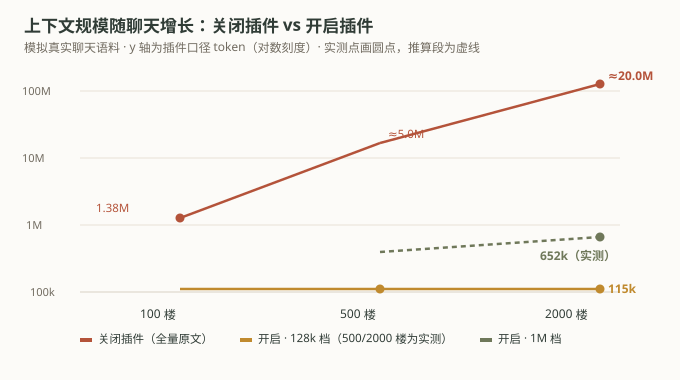
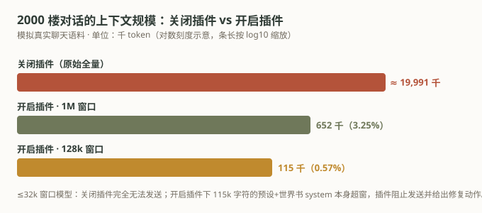
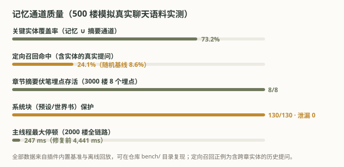
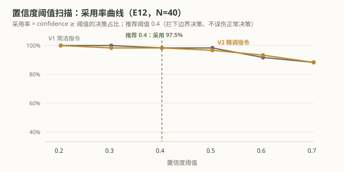

# 大聪明 · 记忆管理与上下文压缩

<p align="center">
  
</p>

> 🔬 **[完整对比实验结果（bench/COMPARISON.md）](bench/COMPARISON.md)** —— 三态对照（关闭插件 / 规则决策 / 决策模型）、机制章节、配对设计与 9 篇参考文献。一句话结论：**2000 楼 2,000 万 token 的聊天被压到 11.5 万（0.57%）仍可对话，关键事实保留 62~73%，系统块 130/130 零丢失，全部数据可复现。**

| 三态对照 | 结果 |
|---|---|
| **关闭插件** | 2000 楼 ≈ 2,000 万 token，任何 ≤1M 窗口模型不可发送 |
| **开启插件（规则决策）** | 压至 0.57%~3.25%，0 次越窗；system 130/130 零泄漏；实体覆盖 62~73%；召回 2.8× 随机基线 |
| **开启 + 决策模型（Jev）** | 意图判定优于规则（55% 楼层点不同且人工审查全数支持）；决策延迟 p50 228ms；代价占净收益 0.09% |

> 给 SillyTavern 用的记忆与上下文编排运行时：**可解释、可回滚、预算感知**。零第三方依赖，本地优先，默认不把任何内容发往外部服务；压缩只作用于「发送给模型的副本」，聊天原文永不改动。

---

## 目录

```
大聪明/
├─ manifest.json                酒馆「安装扩展」用的清单（js/css 指向 extension/dacongming/）
├─ package.json                 根清单：把仓库 clone 到 plugins/ 即成为可用的服务端插件
├─ extension/dacongming/        SillyTavern 浏览器扩展（index / ui / bridge / style）
├─ server/                      记忆服务内核（零第三方依赖，附 node --test 测试套件）
├─ bench/                       对比实验结果（COMPARISON.md）+ 图表
├─ st-plugin/dacongming/        SillyTavern 服务端插件：内嵌形态（随 ST 运行，无窗口无端口无配对）
├─ st-bridge/dacongming-memory/ 服务端桥接插件（独立服务 + 手机 / 局域网同源访问）
└─ launcher/                    安装 / 启动 / 停止 / 卸载脚本
```

## 它做什么

| 能力          | 说明                                                                                                           |
| ----------- | ------------------------------------------------------------------------------------------------------------ |
| **自动压缩上下文** | 上下文接近模型上限时按固定梯度压缩：去重 → 移除过期事实 → 减少低相关召回 → 最老原文转**抽取式摘要** → 合并摘要 → 截断最老内容。系统提示、角色卡、世界书、你的最新输入与手动固定的内容**永不压缩** |
| **自动记忆**    | 后台从对话里抽取事实、人物/地点/物品/关系、章节摘要、待办与时间线，形成可查、可改、可删的记忆库                                                            |
| **相关召回**    | 下一轮按 关键词 + 实体 + 时间 混合检索并注入（自建中文倒排 + BM25，不依赖向量模型）                                                            |
| **可解释**     | 每轮记录「为什么保留 / 为什么压缩 / 召回了什么」，在记忆中心可逐条查看                                                                       |
| **可回滚**     | 每次压缩前自动生成快照，可一键恢复；也能手动创建快照                                                                                   |
| **隐私可控**    | 默认**仅本地处理**，不向任何外部服务发送内容                                                                                     |
| **可迁移**     | 支持从 Horae / 柏宝书 / shujuku / Anima RAG / MessageLimit / 手写总结 / 通用 JSON 导入，可回滚                                 |

**它不会做的事**：不修改你的聊天记录、角色卡、预设、世界书；不做向量化；不联网（除非你显式打开对应开关）。

## 实测数据：装上之后到底差多少

口径：**模拟真实聊天语料**（500 / 2000 楼两档，中英混合 RP，含 115k 字符的真实预设+世界书 system），插件侧全部为可复现实测——结果与复现脚本见 [bench/COMPARISON.md](bench/COMPARISON.md)。

### 硬指标一览

| 维度 | 实测结果 |
|---|---|
| **压缩** | 2000 楼 2,000 万 token → **11.5 万（128k 档）/ 65.2 万（1M 档）**；1000 楼回放 10 检查点 **0 次越窗** |
| **记忆** | 关键实体覆盖 **62~73%**；伏笔埋点章节摘要存活 **8/8**；重复率 0；记忆维护**零 LLM 生成成本** |
| **召回** | 定向命中 **24.1%**（随机基线 8.6%，2.8×）；预算紧张时保底配额 保真 16 / 均衡 10 / 节省 6 严格分层 |
| **系统块保护** | 预设/世界书 **130/130 保留**、摘要泄漏 **0/127**；无法满足预算时阻止发送 + 修复动作，绝不静默截断 |
| **性能** | 2000 楼全流程 23.6s 后台分摊；主线程最大停顿 **247ms**；摘要复用后二次规划 3.2s |
| **多周目管理** | 按聊天自动隔离记忆库；删聊天自动清理副本；「记忆库」面板可重命名 / 删除 / 查看占用 |
| **可解释可回滚** | 每轮计划完整留痕（为什么保留/压缩/召回）；压缩前自动快照一键恢复 |





### 决策层（可选：TypeSafe Jev）

接上 [TypeSafe](https://docs.typesafe.ai/introduction) 的决策模型后，意图判断在 **55% 的楼层点上优于本地规则**（人工审查全数支持，规则存在同输入判定漂移而 Jev 判定一致），决策延迟 p50 **228ms**、成本约占压缩节省的 **0.09%**。端到端压缩输出与规则档趋同（差 18 tokens）——Jev 当前是「更准的仪表盘」，为意图驱动的压缩策略提供可信信号源。



> 技术参考：含 9 篇文献（LLMLingua / MemGPT / MemoryBank / Generative Agents / Lost in the Middle / RAG / BM25 等大厂与高引工作），并把本插件机制放进该脉络定位：**提取式压缩路线、零生成记忆、操作系统式分层预算**。

## 安装

### 方式一 · 酒馆内置「安装扩展」（最省事，只装浏览器扩展）

1. 酒馆 → **扩展** → **安装扩展**（Install extension）
2. 粘贴仓库地址：`https://github.com/tiewangba2020/SillyTavern-DaCongMing`
3. 点「Install just for me」→ 装完点 **Reload**（或重启酒馆）

> **这一步只装浏览器扩展，不含后端。** 没有后端时面板会显示 **「需要处理 · 未检测到服务」**，插件不会压缩、不会记忆、也不会召回 —— 但**不会影响正常聊天**（未连接时一律原样发送）。  
> 要让它真正干活，二选一：
>
> - **再装内嵌服务端插件**（推荐，无需窗口与端口）：按方式三 `git clone` 到 `<酒馆>/plugins/dacongming`，或运行 `launcher/安装到SillyTavern.cmd`；
> - **起独立服务**：运行 `launcher/启动大聪明.cmd`，回面板点 **连接服务** 配对（首次输入服务窗口显示的 6 位配对码）。
>
> ⚠️ **别让同一份扩展装两遍**（例如既用内置安装器装了 `<仓库名>/`、又用脚本装了 `dacongming/`）——会出现两个面板。只保留一种即可。

### 方式二 · 脚本安装（扩展 + 内嵌服务端插件，推荐）

1. 双击 `launcher/安装到SillyTavern.cmd`，按提示回答三个问题：
   - `请输入 SillyTavern 根目录（包含 server.js 的目录）：` → 粘贴**含 `server.js` 的那层文件夹**路径
   - `是否安装内嵌服务端插件（推荐：不用窗口、不用配对）？[Y/n]` → **直接回车**
   - `是否安装同源桥接插件（手机/局域网访问且使用独立服务）？[y/N]` → **输入 `n`**（本机使用不需要）
2. **完全关掉 SillyTavern 再重新启动**（服务端插件只在启动时加载）。
3. 刷新页面 → 扩展面板找到「大聪明」→ 打开 **自动管理**。

### 方式三 · 一条命令装全前后端（推荐，可自动更新）

```bash
git clone https://github.com/tiewangba2020/SillyTavern-DaCongMing.git <酒馆目录>/plugins/dacongming
```

**就这一条命令，前端 + 后端全装好**：

- **后端（服务端插件）**：根 `package.json` 的 `main` 指向插件入口，酒馆 `plugin-loader` 直接加载（需 `config.yaml` 里 `enableServerPlugins: true`）；
- **前端（浏览器扩展）**：插件启动时自动把 `extension/dacongming` 同步到 `<酒馆>/public/scripts/extensions/third-party/dacongming`，刷新页面即可看到扩展面板；
- **自动更新**：插件启动时**自带更新检查**——自动快进到远端最新版并提示「重启生效」；历史分叉时会在诊断页给出手动修复命令。酒馆的 `enableServerPluginsAutoUpdate`（ST 默认关）只是另一条备用通道；
- **卸载**：删掉 `plugins/dacongming` 与 `public/scripts/extensions/third-party/dacongming` 两个目录即可。

> 同源桥接插件（`st-bridge/dacongming-memory`）**不需要装**：内嵌插件本身就是同源的。桥接只在「记忆服务用独立进程跑 + 浏览器不在服务所在机器」时才有意义——那种情况按方式二安装脚本处理。

#### 要不要装「同源桥接插件」？一张表看清

| 你的用法 | 推荐装法 | 桥接插件 |
|---|---|---|
| 就在这台电脑上用酒馆 | 方式三（内嵌） | ❌ 不需要 |
| 酒馆跑在手机 Termux 上，就用这台手机聊 | 方式三（内嵌） | ❌ 不需要（`127.0.0.1` 就是本机） |
| 酒馆在云端/服务器，浏览器远程访问 | 方式三（内嵌）+ 反代转发 `/api/plugins/*` | ❌ 不需要 |
| 电脑跑酒馆，局域网手机/平板访问 | 方式三（内嵌） | ❌ 不需要（同源相对路径自动指向电脑） |
| 用**独立服务**（`启动大聪明.cmd`，8787 端口）+ 本机浏览器 | 独立服务 + 配对 | ❌ 不需要（本机直连） |
| **独立服务** + 手机/局域网/云端浏览器访问 | 独立服务 + 桥接 | ✅ **只有这种情况才装** |

**口诀：走方式三（内嵌插件）就永远不用装桥接。** 桥接只解决一个问题——「记忆服务是独立进程，而浏览器不在它那台机器上」，此时它充当酒馆与独立服务之间的同源代理。

补充：完全重启 SillyTavern（服务端插件只在启动时加载）→ 刷新页面 → 扩展面板找到「大聪明」→ 打开**自动管理**。

### 独立服务形态（可选）

适合「记忆服务不随 ST 重启」或「多个 ST 共用一个记忆库」。安装脚本第 2 步选 `n`、第 3 步选 `y`（装同源桥接插件），然后：

```bash
launcher/启动大聪明.cmd                  # 默认只监听 127.0.0.1:8787
# 或直接跑内核：
cd server && node src/index.js --port 8790 --data-dir D:/dcm-data --log-level debug --store journal
```

刷新页面 → 扩展面板 → **连接服务** → 首次需输入服务窗口显示的 6 位配对码。

> 扩展会自动按「内嵌插件 → 同源桥接 → 直连」的顺序选择可用链路，不需要手动切换。

### 四种使用场景怎么装

先记住一件事：**扩展装在「酒馆服务端」，不在某一台设备上。** 只要酒馆跑起来，任何能打开酒馆的浏览器（同一台电脑、手机、云端远程）都会自动加载它，不用在每台设备上重复安装。真正需要按场景区分的是**后端（记忆内核）装在哪、浏览器能不能访问到它**。

| 场景                         | 后端怎么装            | 一句话关键点                               |
| -------------------------- | ---------------- | ------------------------------------ |
| **电脑端**（浏览器与酒馆同机）          | 内嵌服务端插件          | 同机同源，最省事，推荐                          |
| **手机 Termux**（酒馆跑在手机上）     | 内嵌服务端插件          | 手机自己就是服务器，`127.0.0.1` 指向手机本身         |
| **云端**（VPS / 云主机 / Docker） | 内嵌服务端插件          | 反向代理必须转发 `/api/plugins/*`，且**必须开鉴权** |
| **电脑运行、局域网给手机**            | 内嵌服务端插件（推荐）或同源桥接 | 手机**连不到**电脑的 `127.0.0.1`，必须走同源       |

---

#### 场景一 · 电脑端（Windows / macOS / Linux，浏览器与酒馆同机）

最省事，用**内嵌服务端插件**：不用额外窗口、不用端口、不用配对码。

1. **装扩展**：酒馆 → 扩展 → 安装扩展 → 粘贴仓库地址（方式一）；或直接跑方式二脚本（会自动一起装）。
2. **装内嵌服务端插件**（二选一）：
   - 命令行（全平台通用）：
     ```bash
     git clone https://github.com/tiewangba2020/SillyTavern-DaCongMing.git <酒馆目录>/plugins/dacongming
     ```
   - 或双击 `launcher/安装到SillyTavern.cmd`（Windows，脚本第 2 步选 `Y`）。
3. 确认 `<酒馆目录>/config.yaml` 里 **`enableServerPlugins: true`**（默认是 `false`，改成 `true`）。
4. **完全关掉酒馆再重启**（服务端插件只在启动时加载）。
5. 启动窗口应出现：
   ```
   [大聪明] 服务端插件 v0.1.0 已加载：挂载 38 条路由于 /api/plugins/dacongming（内核 v0.1.0）
   ```
6. 刷新页面 → 扩展面板 → 状态 **● 正常** → 打开 **自动管理**。

**运行环境**：酒馆自身要求 Node ≥ 20，但大聪明的 SQLite 权威存储用的是 Node 内置 `node:sqlite`，需要 **Node ≥ 22.13**。低于这个版本会**自动降级**为 append-only 的 `journal` 存储 —— 功能完全一样，只是大数据量下性能略低。`node -v` 一看便知。

> macOS / Linux 没有 `.cmd` 脚本，用上面的 `git clone` 即可；扩展在酒馆界面里点「安装扩展」装。

---

#### 场景二 · 手机端 Termux（酒馆直接跑在手机上）

Termux 是 Android 上的 Linux 终端，酒馆可以整个跑在里面，大聪明照常装。

```bash
# 1. 装依赖（Termux 里的 nodejs 通常是 22.x / 24.x，够用）
pkg update && pkg install -y nodejs git

# 2. 看一眼 Node 版本：≥22.13 用 SQLite，否则自动用 journal（功能一样）
node -v

# 3. 进入你的酒馆目录（假设是 ~/SillyTavern）
cd ~/SillyTavern

# 4. 装内嵌服务端插件（和电脑端一模一样）
git clone https://github.com/tiewangba2020/SillyTavern-DaCongMing.git plugins/dacongming

# 5. 把 config.yaml 里的 enableServerPlugins 改成 true，然后重启酒馆
```

然后在手机浏览器里打开酒馆 → 扩展 → 安装扩展 → 粘贴仓库地址。

**Termux 专属注意点**：

- 手机浏览器访问的是 `http://127.0.0.1:8000` —— **手机自己就是服务器**，所以内嵌插件（同源）天然可用，不需要配对码。✅
- **别用「直连模式」**：在 Termux 里另起独立服务、再让手机浏览器连 `127.0.0.1:8787` 也能通，但纯属多此一举；内嵌插件更省事。
- **防止 Termux 被系统杀后台**：进 Termux 后执行 `termux-wake-lock`，并在安卓「设置 → 应用 → Termux → 电池」里关掉省电优化。
- 如果酒馆数据放在共享存储（`/sdcard`），首次需要执行一次 `termux-setup-storage` 授权。
- 手机端 CPU 较弱，建议把目标档位设成「节省用量」；记忆中心的「迁移导入」批量操作会比较慢，属正常。

---

#### 场景三 · 云端（VPS / 云主机 / Docker / 云 IDE）

酒馆跑在云服务器上，你用浏览器远程访问。安装步骤同电脑端（扩展 + 内嵌服务端插件），但下面几条**必须做**：

1. **`config.yaml` 里 `enableServerPlugins: true`**。
2. **必须开鉴权**：`basicAuthMode: true`（或在酒馆里建用户账号）。  
   服务端插件的路由在酒馆的登录鉴权**之后**才生效，所以只要酒馆鉴权开着，记忆库就不会裸奔。**反过来，如果酒馆没有任何鉴权，公网上的任何人都能读你的记忆库。**
3. **反向代理要转发全部路径**，尤其是：
   - `/api/plugins/*`（内嵌插件、SSE 事件流）
   - `/scripts/extensions/third-party/*`（扩展的 js / css 静态资源）
   只转发 `/` 和 `/api/chat` 是不够的。SSE 长连接（`/api/plugins/dacongming/events`）不要被缓冲，Nginx 加一行：
   ```nginx
   location / {
       proxy_pass http://127.0.0.1:8000;
       proxy_buffering off;          # SSE 必须关缓冲，否则「记忆中心」实时刷新会卡住
       proxy_read_timeout 3600s;
   }
   ```
4. **HTTPS 无需额外配置**：扩展访问后端用的是相对路径（同源），域名/证书怎么变都自动跟随。
5. **Docker 部署**：把 `plugins/` 挂成卷（或在容器内 `git clone`），容器重启后生效。
6. 云端同样是**同源**，所以不需要配对码、不需要对外暴露 8787 端口 —— 8787 应该只监听 `127.0.0.1`。

> ⚠️ 云端最常见的坑：**反代只转发了一部分路径**，扩展探测 `/api/plugins/dacongming/health` 拿到 404 或一段 HTML，面板就永远停在「未检测到服务」。  
> **排查方法**：在浏览器地址栏直接打开 `https://你的域名/api/plugins/dacongming/health`，正常应返回 `{"ok":true,"service":"dacongming-memory-service",...}`。返回 HTML 就是没转发到酒馆。

---

#### 场景四 · 电脑运行、局域网给手机用（手机浏览器访问电脑上的酒馆）

电脑跑酒馆 + 大聪明，手机在同一 WiFi 下用浏览器打开 `http://<电脑局域网IP>:8000` 聊天。

**核心原则：手机上的扩展必须走「同源」链路，绝不能走「直连 127.0.0.1」。**  
因为手机浏览器里的 `127.0.0.1` 指的是**手机自己**，而不是电脑 —— 直连模式在这里必然失败。

两种同源方案，**推荐 A**：

**A. 内嵌服务端插件（推荐）**

- 电脑上按「场景一」装好内嵌服务端插件即可。
- 手机扩展探测的是相对路径 `/api/plugins/dacongming/health`，会自动指向 `http://<电脑IP>:8000/api/plugins/...` → 天然可达。✅
- 手机上**不用**再装一次扩展：扩展存在酒馆服务端，手机打开酒馆就自动加载。

**B. 同源桥接插件（只有你坚持用「独立服务」时才需要）**

- 电脑上跑独立服务：`launcher/启动大聪明.cmd`（监听 `127.0.0.1:8787`，只在本机）。
- 把 `st-bridge/dacongming-memory/` 整个目录拷到 `<酒馆目录>/plugins/dacongming-memory/`，重启酒馆。
- 手机扩展探测 `/api/plugins/dacongming-memory/health` → 电脑上的桥接插件替手机转发到电脑本机的 `127.0.0.1:8787`。✅

**酒馆侧必须做的局域网设置**（这部分属于酒馆本身，不是大聪明）：

1. **让酒馆监听局域网**：`config.yaml` 里 `listen: true`（或用命令行 `--listen`）。默认 `listen: false` 只监听本机，手机连不上。
2. **放行局域网**：`whitelistMode: true` 时要把网段加进白名单（支持 CIDR）：
   ```yaml
   whitelist:
     - ::1
     - 127.0.0.1
     - 192.168.1.0/24      # ← 你的局域网网段，按实际改
   ```
   也可以临时 `whitelistMode: false`，但那等于**同一个 WiFi 下谁都能打开你的酒馆**，不建议。
3. **强烈建议 `basicAuthMode: true`**，否则同一 WiFi 下任何人都能访问你的聊天与记忆库。
4. **放行防火墙 8000 端口**（Windows：入站规则；Linux：`sudo ufw allow 8000`）。
5. **查电脑的局域网 IP**：Windows `ipconfig`、Linux/macOS `ip addr`（或 `ifconfig`）。手机和电脑必须在**同一个 WiFi**。
6. 手机浏览器打开 `http://<电脑IP>:8000`，装扩展（方式一），刷新后面板应显示 **● 正常**。

> 一句话总结场景四：**后端跟着酒馆走（内嵌插件），手机只管打开酒馆网页。** 只要酒馆能被手机访问，大聪明就跟着能用。

## 五分钟上手

1. **安装**（见上，任选一种），需要的话重启 SillyTavern。
2. **确认连上**：点酒馆的 **扩展** 按钮（积木图标）→ 展开 **大聪明 · 记忆与上下文压缩** → 状态应显示 **● 正常**。
3. **打开「自动管理」**：点开关或点「自动管理」几个字都行。做完这一步插件就开始工作了 —— 不用写正则、不用选模型、不用调阈值。
4. **正常聊天**：前 20 轮是「观察期」，只在后台默默记录，**完全不会改动**你发给模型的内容；20 轮之后开始注入相关旧记忆、并在上下文快满时自动压缩。它坏了也只会「原样发送」，不会卡住你的聊天。
5. **想看它做了什么**（可选）：扩展面板 → **打开记忆中心**。

> 成功的样子：酒馆启动窗口里出现  
> `[大聪明] 服务端插件 v0.1.0 已加载：挂载 38 条路由于 /api/plugins/dacongming`

## 一张速查表：我想……该点哪里？

| 我想                  | 去哪里点                                           |
| ------------------- | ---------------------------------------------- |
| 让它开始工作 / 临时停掉       | 扩展面板 → **自动管理** 开关                             |
| 让它更省 token / 更保真    | 扩展面板 → **目标档位**（保真优先 / 均衡 / 节省用量）              |
| 看它记住了什么             | 记忆中心 → **记忆列表**                                |
| 纠正记错的事实             | 记忆列表 → 对应那条 → **纠正**                           |
| 让它别再提某件事            | 记忆列表 → 对应那条 → **不再记忆**（持久阻断，重启也不复活）            |
| 让它永远记着某件事           | 记忆列表 → 对应那条 → **固定**；或手动新增一条                   |
| 看上一轮为什么压缩           | 记忆中心 → **本轮计划**                                |
| 撤销上一次压缩             | 记忆中心 → **本轮计划** → 撤销本次压缩；或 **快照与恢复**           |
| 备份 / 导出记忆           | 记忆中心 → **迁移导入** → 导出 JSON；或 **快照与恢复** → 立即创建快照 |
| 从旧插件（Horae/柏宝书等）搬过来 | 记忆中心 → **迁移导入** → 选来源 → 扫描并预览 → 试运行 → 提交（可回滚）  |
| 中止卡住的后台任务           | 记忆中心 → **诊断** → 任务队列 → 取消                      |
| 出问题了想自查             | 记忆中心 → **诊断**                                  |

## 主面板

收起时只有一行（状态点也看得见）：**大聪明 · 记忆与上下文压缩　● 正常　⌄**。展开后分三区：

| 区域          | 内容                                                                                                                          |
| ----------- | --------------------------------------------------------------------------------------------------------------------------- |
| **自动管理与状态** | 总开关；状态含义：**正常**（无需操作）/ **后台处理中**（等一下）/ **已降级**（本轮做了压缩，可去「本轮计划」看原因并回滚）/ **需要处理**（连不上服务，或压缩后仍超预算被阻止发送）                        |
| **记忆与压缩**   | **目标档位**（`保真优先` 更晚触发、保留更多原文 / `均衡（默认）` / `节省用量` 更早压缩、注入更少；**档位不改变隐私许可、原始聊天留存或作用域边界**）；**本轮上下文**（注入 token、压缩比例与节省、计划结果、决策来源） |
| **隐私与授权**   | **隐私许可**三档；**可选的独立开关** 4 个，默认全关（见「隐私与安全」）                                                                                   |

> 开关状态与服务端**双向同步**：服务端已有配置（例如内嵌插件首次建库时的初始配置）时，连接后以服务端为准；你在界面上改过之后，就以你的选择为准并推送回服务端。

## 记忆中心

顶部 6 个标签页：

| 标签页       | 能做什么                                                                                                                          |
| --------- | ----------------------------------------------------------------------------------------------------------------------------- |
| **记忆列表**  | 按 关键词 / 作用域 / 类型 / 状态 / 时间 / 来源 / **楼层区间** / **角色（说话人）** 筛选。每条可 **固定 / 纠正 / 不再记忆 / 查看来源 / 恢复**                                |
| **本轮计划**  | 结构化展示最近一轮的完整决策：本轮概览（结果、压缩比例、`基线 → 最终`、token 口径、**触发原因**、耗时）、为什么这样做、注入内容、消息处理（保留/压缩/丢弃的楼层与原因）、召回来源。顶部按钮：**仅预览（只读）**、**撤销本次压缩** |
| **快照与恢复** | **立即创建快照**、**重建索引**、恢复任一历史快照                                                                                                  |
| **记忆体检**  | 检查 7 类问题并给修复动作：冲突、过期、无来源、孤儿来源、跨作用域污染、重复摘要、损坏索引                                                                                |
| **迁移导入**  | 从旧插件导入（只读扫描 → 映射预览 → 去重报告 → 试运行 → 提交 → **可回滚**，幂等）；导出/导入大聪明自己的 JSON；**彻底删除插件副本（本聊天）**（不动 SillyTavern 原始聊天）                    |
| **诊断**    | 服务状态、压缩账本（累计节省）、**环境与兼容（自动探针）**、任务队列（可取消）、最近诊断事件；底部有默认折叠的原始数据                                                                 |

> **楼层筛选注意**：只有自动抽取与章节摘要产生的记忆带楼层信息；手动新增、从旧插件导入的记录没有楼层，**一旦使用楼层筛选就会被排除**（筛选条会提示）。

## 一次发送时发生了什么

1. 你按下发送前，扩展把「当前聊天 + 可读取的硬约束块（系统提示/角色卡/世界书）+ 模型上下文上限与输出预留」发给记忆服务。
2. 服务按预算编排：**最近原文 > 你固定的锚点 > 相关召回 > 章节摘要 > 冷数据**。
3. 预算不足时按固定梯度降级（去重 → 移除过期事实 → 减少低相关召回 → 最老原文转摘要 → 合并摘要 → 截断最老内容）。
4. 扩展应用计划，再用 SillyTavern 自带 tokenizer 精确复核；仍超预算则做一次更激进的规划；**仍无法满足就阻止发送并给出修复动作**（而不是发一个必然被截断的请求）。
5. 模型收到的是压缩后的副本；**你的聊天原文不动**。
6. 回复落地后，后台异步抽取候选记忆、生成章节摘要、更新索引 —— 不阻塞回复。

## 记忆的生命周期与压缩时机

```
candidate（候选） → observed（已观察） → confirmed（已确认） → active（生效）
                                        ↘ superseded / expired（被取代/过期） → archived（归档）
```


- 只有 **observed / confirmed / active** 会被注入；candidate 与 conflict 只展示、不注入。
- **观察期**：自动抽取的事实先记为 candidate 观察一段时间（内嵌插件默认「前 20 轮」）；你手动添加/纠正/固定的记忆**立即生效**。观察期**结束时**，仍停在 candidate 的记录会按置信度**自动补晋升**一次，不会白记。
- 低置信度或与已有事实冲突的内容会停在候选/冲突状态，**不会直接覆盖已确认事实**。
- **压缩什么时候开始？** 由「目标档位」决定：上下文用掉可用预算的 **85%（保真优先）/ 75%（均衡）/ 60%（节省用量）** 时开始轻量压缩，压回该线以下即停；真的越过硬上限才继续做更强的截断。

## 我已经聊了几千楼，装上会怎样？

不会炸，但第一次会「重新整理」一遍。以 3000 楼、约 15 万字为例（实测）：

1. **打开那个聊天时**：插件在后台把整个聊天同步给记忆服务（一次性，约 0.2 秒写库 + 约 0.35 秒抽取，期间界面会有一次很短的小卡顿），抽出约 1000 条记忆。
2. **第一次发送时就会压缩**：3000 楼远超任何模型的上下文，会被压到上限以内 —— **最近若干楼保留原文，更早的楼压成摘要、装不下的丢弃**：

   | 上下文上限 | 保留原文 | 保留摘要 | 丢弃   |
   | ----- | ---- | ---- | ---- |
   | 8k    | 53 楼 | 107 楼 | 2840 楼 |
   | 32k   | 212 楼 | 948 楼 | 1840 楼 |
   | 128k  | 847 楼 | 2153 楼 | 0 楼  |

   压缩前**自动建快照**，不满意可在「本轮计划 → 撤销本次压缩」或「快照与恢复」里回滚。
   同时后台会陆续生成章节摘要（几十个任务，十几秒内跑完；这期间**不会卡死**，只是后台慢慢补，下一轮起直接复用）。
3. **前 20 轮不注入记忆**：抽出的记忆先是 candidate（观察期）。20 轮后自动补晋升，开始参与召回。
4. **超长聊天里的召回**：楼层非常多时上下文会长期处于「超预算」状态，降级顺序是**先丢低相关召回、再压旧原文**。本版给召回留了**保底配额**（保真优先 6% / 均衡 4% / 节省用量 2%），所以定向回忆始终有一席之地；想让它更有效，可以把目标档位调到「保真优先」，或给超长剧情开新分支。

### 情感变化、暗线伏笔能同步到位吗？

能保住，但要分三条通道看，保真度不一样（实测 3000 楼、埋 8 个情感/伏笔关键点）：

| 通道              | 保真度   | 说明                                                          |
| --------------- | ----- | ----------------------------------------------------------- |
| **章节摘要**（防丢）    | **8/8** | 埋点所在的楼层被压缩时，那句话会被**原文摘录**进章节摘要，不会被同句式的填充句挤掉                 |
| **独立记忆**（可检索）   | **4/8** | 含「其实 / 原来 / 变成了 / 第一次 / 别过脸」等信号的埋点会被抽成独立事实记忆；**纯细节描写不会** |
| **召回注入**（能带出来）  | 相关即可  | 用相关的话去问（「那半枚玉佩是谁的」「他现在什么态度」），摘要与记忆都能被检索并注入                  |

实测细节：

- **章节摘要 8/8**。这里修过一个真实缺陷：早期版本的摘要打分只看「命中多少关键词」，导致同一句式换词的填充句（「我问他：XX 到底把 YY 拿哪里了？」）靠实体命中把预算占满，真正承载伏笔的叙述句被挤掉 —— 当时只有 **3/8** 存活。现在打分加入了**词汇稀有度（IDF）**与**新颖度**：全章只出现一两次的词（玉佩、断口、信物）比反复出现的槽位词（人名、口头禅）权重大得多。
- **独立记忆 4/8**。这条通道是**规则抽取**，只认关键词。所以「冷冷地别过脸去」这类靠神态暗示的转折，本版已单独加了一条规则来捞；但**纯细节伏笔（一句不带任何情感/转折词的怪描写）仍只能靠摘要保住**，不会被单独列成一条记忆。
- **召回是按你当前这句话去检索的**：你不问，它不会主动把伏笔搬出来。想让它主动带出旧线索，问题里带上相关的人名/物品名最有效。

> 简单说：**它不会改你的聊天记录**，只是每次发送前重算一份「能塞进模型的版本」，并且每一步都可回滚。老聊天第一次用会觉得「变化挺大」，这是正常的。

## 隐私与安全

- **默认仅本地处理**：规则抽取、SQLite 存储、关键词检索，不向任何外部服务发送内容。
- 外部相关能力**默认全关**。其中 **Jev 已实现**（在面板「高级设置 · TypeSafe Jev」里配置端点，保存即热生效）；**远程 Embedding / 云同步 / 遥测尚未实现**，开关灰显标注、打开不会有任何效果 —— 也就是说，本版本不存在任何「把内容发到外部」的代码路径。
- 日志只记录摘要、哈希、来源 id、耗时与错误类型，**不保存私密正文**。
- 插件修改的是「发送给模型的副本」，**SillyTavern 的原始聊天/角色卡/预设/世界书永不被改写**。
- 四种删除语义严格区分：*不再召回*（tombstone 阻断）/ *忘记派生记忆* / *彻底删除插件副本* / *删除 ST 原消息（由你自己在 ST 里操作）*。
- 内嵌形态复用 SillyTavern 自身的登录鉴权；独立服务默认只监听 loopback，并使用随机配对凭证。

## 故障排查

**按顺序做这三件事，能解决九成问题**：① 刷新页面（F5）→ ② **完全重启** SillyTavern（不是刷新，是关掉再开）→ ③ 看启动窗口有没有 `[大聪明] 服务端插件 v0.1.0 已加载` 这一行。

| 现象                         | 原因与处理                                                                                                            |
| -------------------------- | ---------------------------------------------------------------------------------------------------------------- |
| 面板一直「未检测到服务」               | ① **只装了浏览器扩展、还没装后端**（见「安装 · 方式一」的说明）；② 没重启 ST；③ `config.yaml` 里 `enableServerPlugins` 不是 `true`（改成 `true` 后必须重启） |
| 控制台报 `Invalid CSRF token…` | 页面会话令牌过期（常见于 ST 重启过）。**刷新页面（F5）** 即可；插件已自动带 `X-CSRF-Token` 并在 403 时重试一次                                          |
| 记忆列表一直是空的                  | ① 自动管理没开启（空状态里点「打开自动管理」）；② 还在观察期；③ 当前是「本聊天」作用域，切到「全部作用域」看看；④ 被筛选条挡住了（会给「清除筛选」按钮）                                 |
| 某条记忆没被注入                   | 状态是 candidate / 作用域或分支不匹配 / 已过期 / 被「不再记忆」阻断 / 本轮预算不足被裁剪。到「本轮计划」看原因                                               |
| 面板出现「已降级」                  | 正常行为：本轮做了压缩。到「本轮计划」看细节，需要时可回滚                                                                                    |
| 发送被阻止                      | 压缩后仍超硬预算。面板会给修复动作：减少固定注入、降到「节省用量」、提高模型上下文上限，或清理不再需要的大段世界书/预设                                                     |
| 回复明显变慢                     | 首次为大量历史消息建索引会短暂占用 ST（10k 条约 100ms）。可在插件 `config.json` 把 `storeKind` 设为 `journal`，或改用独立服务形态                       |
| 按钮/文字显示异常                  | 多为主题 CSS 冲突，截图反馈即可（插件已对常见 flex 压缩做处理）                                                                            |
| 手机/局域网能打开酒馆，但面板「未检测到服务」    | 多半是后端没走同源：确认装的是**内嵌服务端插件**（不是只起了独立服务），且 `enableServerPlugins: true`。**直连模式在手机上必然失败**（`127.0.0.1` 指手机自己），见「场景四」   |
| 手机打不开酒馆页面                  | 这是酒馆的问题：`listen` 没开、白名单没放行局域网网段、或防火墙拦了 8000。见「场景四」第 1~5 条                                                        |
| 云端面板「未检测到服务」，但启动日志有 `已加载`  | 反向代理没转发 `/api/plugins/*`。浏览器直接打开 `https://你的域名/api/plugins/dacongming/health`，返回 HTML 就说明没转发到酒馆，见「场景三」           |

### 已知限制（v0.1.0）

1. **楼层筛选**只对自动抽取与章节摘要产生的记忆有效；手动新增、从旧插件导入的记录没有楼层信息，会被楼层筛选排除。
2. **「立即压缩」暂无入口**：「仅预览」「撤销压缩」「恢复快照」都已提供；「立即压缩」的语义待确定（直接改写你的聊天副本有风险）。请用「仅预览」查看效果，或正常发送一轮让它在发送副本上生效。
3. **召回注入**依赖后台抽取完成；若抽取关闭且未开启自动管理，召回会是 0 条（属预期）。
4. `node:sqlite` 需要 Node ≥ 22.5（22.13 前需 `--experimental-sqlite`），不满足时自动降级为 journal 存储（功能一致、性能略低）。
5. **四个可选开关中只有 Jev 有实现**，且在面板「高级设置」里配置端点（保存即热生效，无需重启）；其余为预留位置，界面已灰显标注。

## 卸载与数据位置

- **卸载**：运行 `launcher/卸载大聪明.cmd`。只删除扩展与插件目录，**不动**记忆数据。
- **数据位置**：内嵌形态在 `<SillyTavern数据目录>/<用户名>/dacongming/`（`memory.sqlite` + `settings.json` + `backups/`）；独立形态在 `server/data/`。
- **想彻底清空记忆**：先在记忆中心导出备份，再删除上述数据目录（或删除后重启 SillyTavern）。

### 内嵌插件配置（可选）

`<酒馆目录>/plugins/dacongming/config.json`：

```json
{
  "serverRoot": "./src",
  "dataSubdir": "dacongming",
  "storeKind": "auto",
  "logLevel": "info",
  "seedSettings": { "autoManage": true, "shadowMode": "first-n", "shadowTurns": 20 }
}
```

`seedSettings` 只在**该用户首次建库**时写入，之后由面板设置接管。

## 术语

| 词                | 含义                        |
| ---------------- | ------------------------- |
| **档位（tier）**     | 压缩激进度：保真优先 / 均衡 / 节省用量    |
| **预算（budget）**   | 上下文上限 − 输出预留 − 安全余量       |
| **降级（degraded）** | 本轮因预算不足做了压缩或裁剪            |
| **锚点（anchor）**   | 你固定的事实，始终注入且优先级最高         |
| **召回（recall）**   | 从记忆库里挑出与当前输入相关的条目注入       |
| **章节摘要**         | 把一段旧对话压缩成的抽取式摘要（逐句摘录，不改写） |
| **观察期（shadow）**  | 抽取结果先不注入、只展示，确认质量后再生效     |
| **作用域（scope）**   | 记忆的归属范围（默认按聊天，也可按角色/全局）   |

## 开发

```bash
cd server
node --test "test/**/*.test.js"     # 161 个用例
node src/index.js                   # 启动独立服务（默认 127.0.0.1:8787）
```

零第三方依赖，只用 Node.js 内置模块。`server/test/repo-layout.test.js` 守卫仓库布局（根 `manifest.json` / 根 `package.json` / 扩展入口必须用绝对路径引用 ST 核心），改动分发相关文件后请先跑它。

## 许可证与来源

以 **MIT** 许可证发布（见 [LICENSE](LICENSE)）。

本项目代码为独立实现，未复用 Horae / 柏宝书 / shujuku / MessageLimit / Anima RAG 的源代码。运行时仅依赖 Node.js 内置模块。TypeSafe Jev 为可选外部服务，需用户自行提供端点与凭据。
